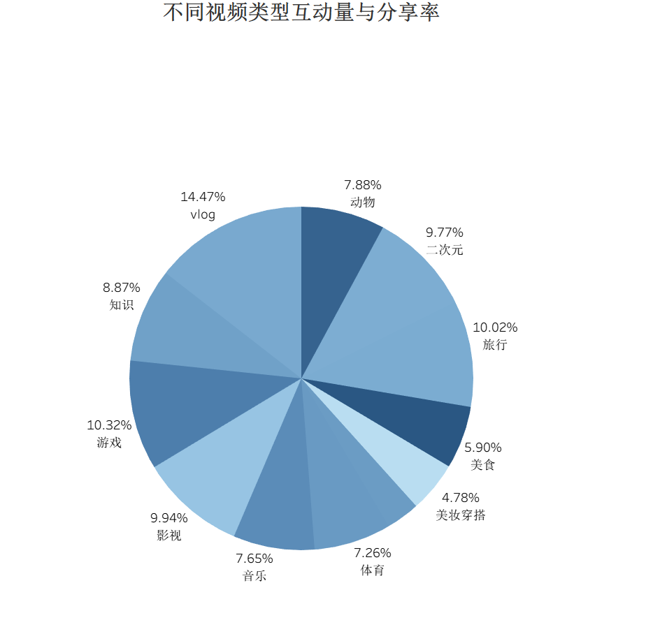
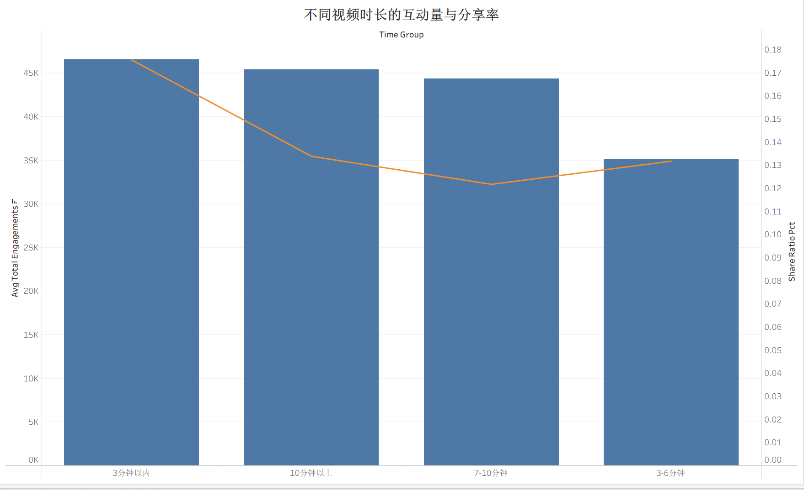
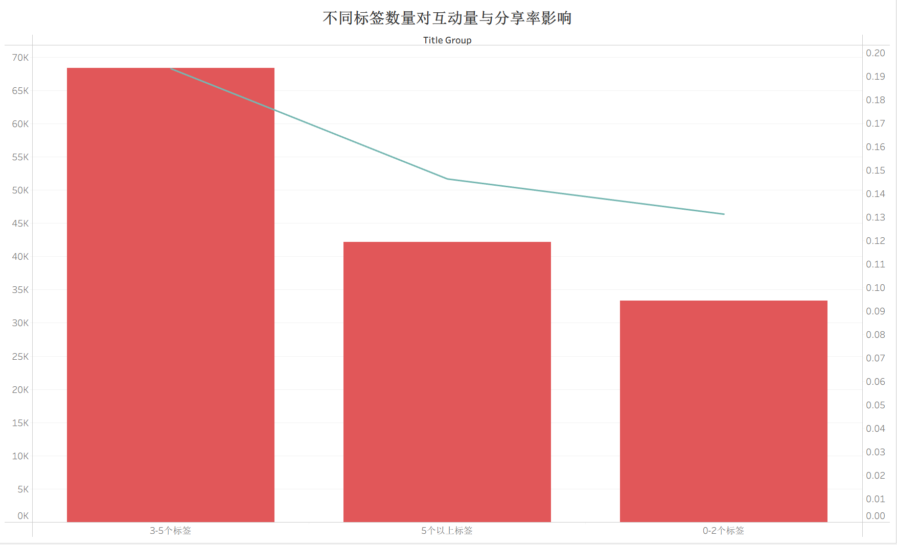
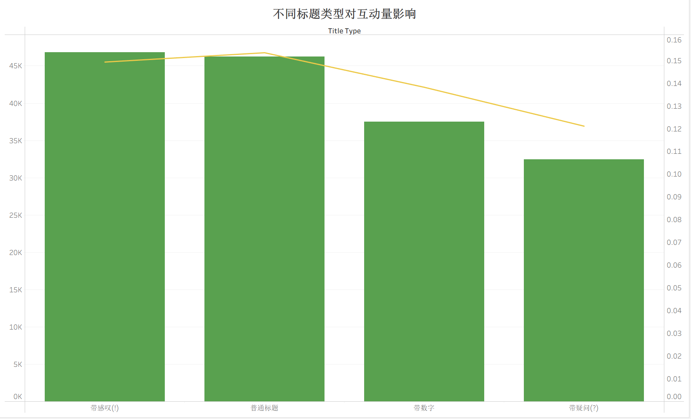
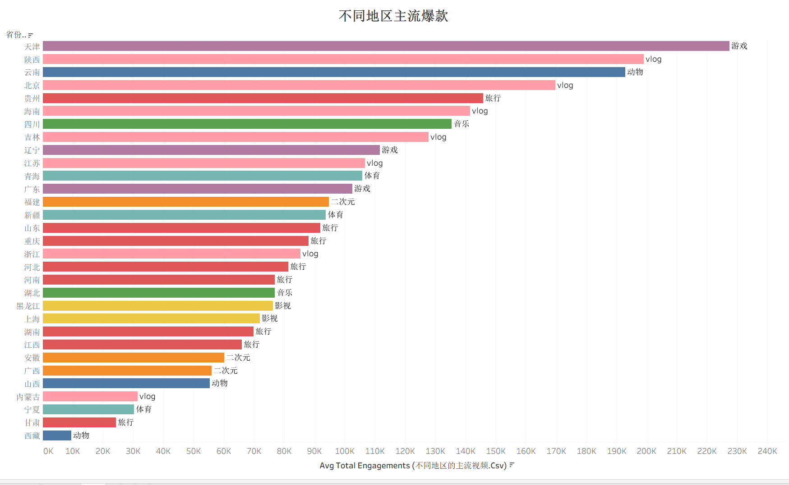

# 抖音短视频互动数据分析

基于抖音短视频公开数据的互动量分析与内容运营策略研究：使用 **Python (pandas)** 完成数据清洗，在 **MySQL** 中按多个维度聚合计算互动指标，再用 **Tableau** 输出可视化图表，最终总结视频类型、时长、标签、标题与地区对互动表现的影响。

## 项目概览

| 环节 | 工具 | 产出 |
| --- | --- | --- |
| 数据清洗 | Python / pandas | [`数据清洗.ipynb`](数据清洗.ipynb) |
| 指标计算 | MySQL | [`douyin.sql`](douyin.sql) → [`data/`](data) |
| 可视化 | Tableau | [`figures/`](figures) |

## 数据说明

- **字段**：原始数据共 24 个字段，包含视频标题、视频描述、作者信息、视频时长、点赞数、评论数、分享数、收藏数、视频链接、发布时间、话题标签、文本标签、音乐信息、视频类型、区域名称、省份名称等。
- **清洗**：剔除关键字段缺失的记录后，由 **25,646** 条降至 **23,167** 条，数据保留率约 **90.33%**；重复记录数为 **0**。
- **数据未随仓库提供**：原始数据集体积约 36 MB 且涉及平台原始内容，因此未纳入版本控制。复现时请将数据文件放到项目根目录，并按 notebook 中的文件路径读取。

## 核心指标

- **互动总量** = 点赞数 + 评论数 + 分享数 + 收藏数
- **分享率** = 分享数 ÷ 互动总量

## 分析发现

### 1. 视频类型

| 视频类型 | 视频数 | 平均互动量 | 分享率 |
| --- | ---: | ---: | ---: |
| vlog | 722 | 73,809 | 13.58% |
| 游戏 | 1,011 | 52,636 | 17.19% |
| 旅行 | 2,803 | 51,105 | 13.36% |
| 影视 | 2,012 | 50,699 | 11.44% |
| 二次元 | 2,543 | 49,837 | 13.26% |
| 知识 | 1,888 | 45,256 | 14.28% |
| 动物 | 2,168 | 40,218 | 19.68% |
| 音乐 | 1,627 | 39,009 | 15.99% |
| 体育 | 1,951 | 37,020 | 14.84% |
| 美食 | 1,792 | 30,099 | 20.65% |
| 美妆穿搭 | 1,553 | 24,397 | 9.30% |
| 汽车 | 1,086 | 16,157 | 14.69% |

> vlog 平均互动量最高；美食、动物、游戏的分享率最高，美妆穿搭与影视的分享率偏低。

### 2. 视频时长

| 时长区间 | 视频数 | 平均互动量 | 分享率 |
| --- | ---: | ---: | ---: |
| 3 分钟以内 | 7,182 | 46,560 | 17.55% |
| 10 分钟以上 | 3,749 | 45,367 | 13.38% |
| 7-10 分钟 | 3,520 | 44,364 | 12.17% |
| 3-6 分钟 | 6,705 | 35,132 | 13.17% |

> 短视频（3 分钟内）互动量与分享率均为最高，3-6 分钟区间表现最弱。

### 3. 文本标签数量

| 标签数量 | 平均互动量 | 分享率 |
| --- | ---: | ---: |
| 3-5 个 | 68,393 | 19.32% |
| 5 个以上 | 42,192 | 14.62% |
| 0-2 个 | 33,303 | 13.12% |

> 使用 3-5 个标签的视频平均互动量约为 0-2 个标签视频的 2 倍，是最优标签数量区间。

### 4. 标题类型

| 标题类型 | 视频数 | 平均互动量 | 分享率 |
| --- | ---: | ---: | ---: |
| 带感叹号 (!) | 5,744 | 46,837 | 14.93% |
| 普通标题 | 12,432 | 46,227 | 15.34% |
| 带数字 | 6,274 | 37,507 | 13.82% |
| 带疑问 (?) | 3,714 | 32,463 | 12.11% |

> 带感叹号的标题互动量最高，带疑问号的标题反而最低，说明情绪化表达比提问式更有效。

### 5. 地区差异

各省份平均互动量最高的视频类型（仅统计视频数 ≥ 5 的省份-类型组合）：

| 省份 | 优势视频类型 | 平均互动量 |
| --- | --- | ---: |
| 天津 | 游戏 | 227,378 |
| 陕西 | vlog | 198,962 |
| 云南 | 动物 | 192,945 |
| 北京 | vlog | 169,800 |
| 贵州 | 旅行 | 145,901 |
| 海南 | vlog | 141,613 |

> 完整 31 个省级行政区结果见 [`data/不同地区的主流视频.csv`](data/不同地区的主流视频.csv)；vlog、旅行、游戏在多省份表现突出。

## 图表

| 不同视频类型 | 视频时长 |
| --- | --- |
|  |  |

| 标签数量 | 标题类型 |
| --- | --- |
|  |  |



## 目录结构

```text
douyin-data-analysis/
├── 数据清洗.ipynb      # 数据清洗（pandas）
├── douyin.sql          # MySQL 分析查询
├── data/               # 各维度分析结果导出
├── figures/            # Tableau 可视化图表
└── README.md
```

## 复现步骤

1. 将原始数据集放到项目根目录；
2. 运行 `数据清洗.ipynb`，生成清洗后的数据集；
3. 将清洗结果导入 MySQL，执行 `douyin.sql` 中的 5 条查询，导出结果到 `data/`；
4. 将 `data/` 中的结果导入 Tableau，重建 `figures/` 中的图表。

## 项目结论

- 内容形式：**vlog、游戏、旅行** 平均互动更高，**美食、动物** 的传播（分享）意愿更强；
- 内容长度：**3 分钟以内** 的短内容表现最佳；
- 内容标签：**3-5 个标签** 是互动最优区间；
- 标题写法：**带感叹号** 的情绪化标题优于提问式标题；
- 地域运营：不同省份存在明显的内容偏好差异，可据此做区域化内容投放。
